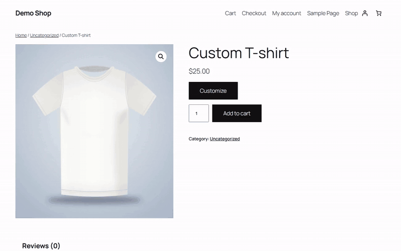
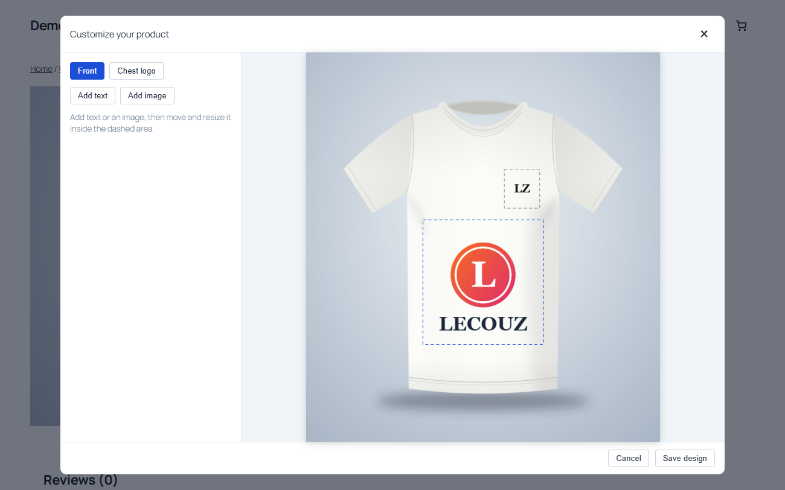
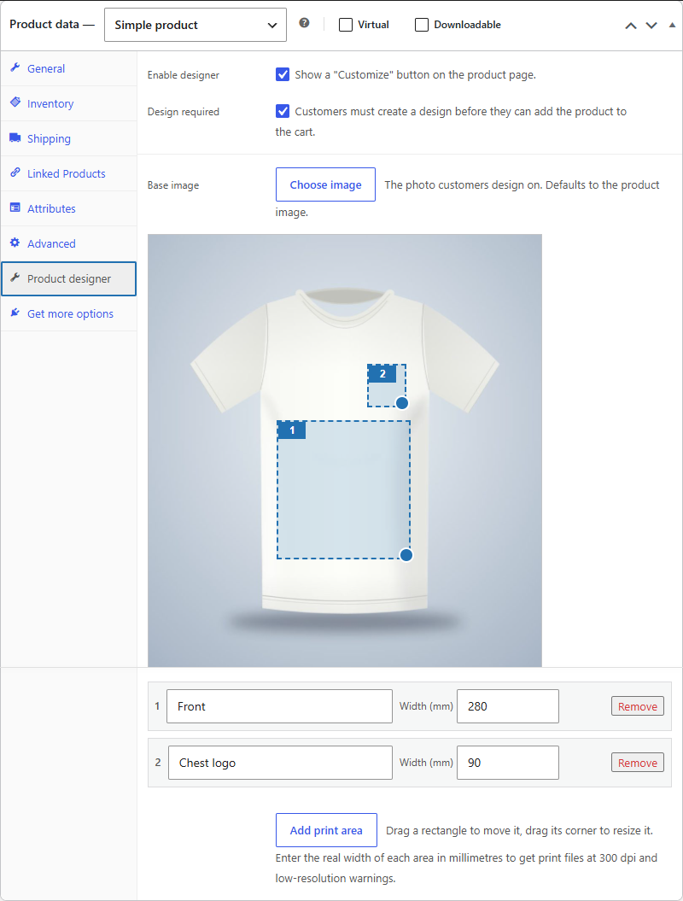
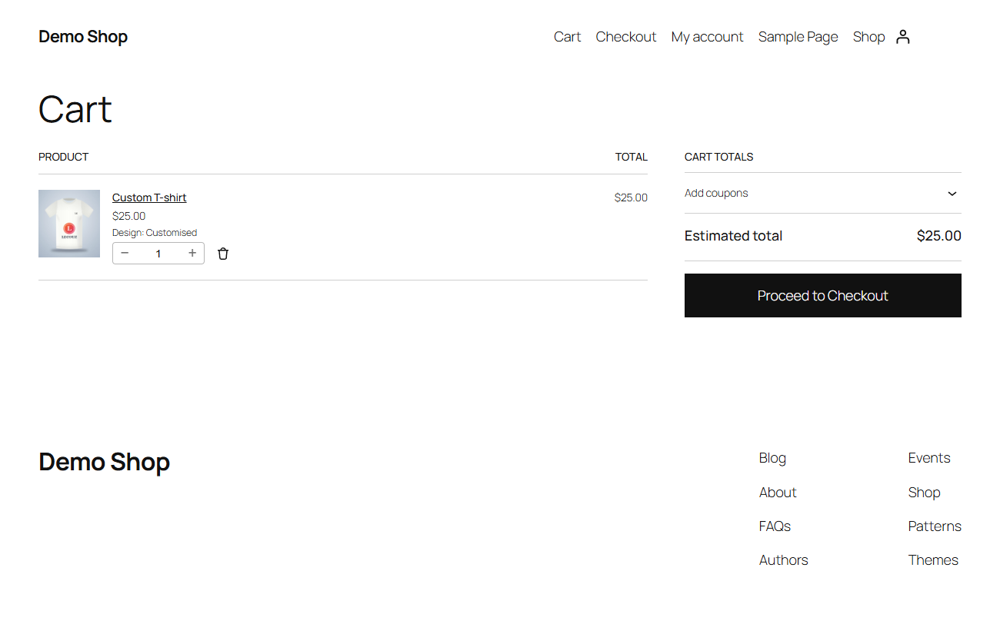
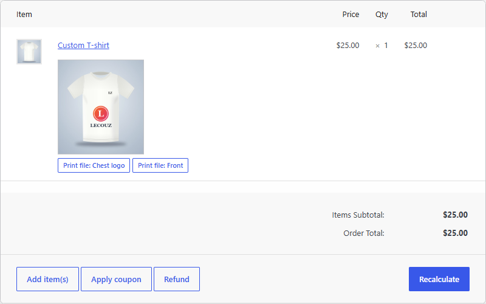

# Lecouz Product Designer

Let customers add their own text and images to WooCommerce products, and get print-ready files with every order.



[**Download the latest .zip**](https://github.com/haaris13/Product-designer/releases/latest/download/lecouz-product-designer.zip) ·
[Watch the 27 s video](docs/demo.mp4) ·
[Product page on lecouz.ch](https://lecouz.ch/product.html?p=product-designer)

Free, GPL-2.0-or-later. No external service, no account, no tracking.

## What it does

- **You** pick a product photo and draw one or more print areas on it (front, back, chest, sleeve...).
- **Your customers** open an editor on the product page, add text and their own images inside those areas, and see the result on the product.
- **Every order** comes with a preview and a transparent print-ready PNG for each area, exported at 300 dpi, downloadable from the order screen.

### Features

- Print areas drawn with the mouse, with their real width in millimetres
- Text: fonts, colour, size, bold, italic, alignment
- Customer image upload (PNG, JPEG, WebP, GIF) with a low-resolution warning
- Design optional or required before the product can be added to the cart
- Preview in the cart, the cart and checkout blocks, the order and the emails
- Works on phones and tablets
- Compatible with High-Performance Order Storage
- Nothing loaded from a third-party server: no CDN, no external fonts

## Requirements

WordPress 6.2+, WooCommerce 8.0+, PHP 7.4+.

## Install

1. Download [`lecouz-product-designer.zip`](https://github.com/haaris13/Product-designer/releases/latest/download/lecouz-product-designer.zip).
2. In WordPress: **Plugins → Add New → Upload Plugin**, choose the zip, then **Activate**. WooCommerce must be active.
3. Edit a product, open the **Product designer** tab in *Product data*, tick **Enable designer** and click **Add print area**.
4. Drag the rectangle where customers can print, enter its real width in millimetres, and save the product.

## Screenshots

| Editor | Product settings |
|---|---|
|  |  |

| Cart | Order with print files |
|---|---|
|  |  |

## Try it without installing anything

Needs Node.js. From the root of this repository:

```bash
npx @wp-playground/cli@latest server --auto-mount --blueprint=docs/playground-blueprint.json --port=9400
```

It starts a throw-away WordPress with WooCommerce and a demo product at <http://127.0.0.1:9400/product/custom-t-shirt/>. The admin is at `/wp-login.php` (`admin` / `password`). Everything is recreated on each start.

## Privacy

The plugin stores designs as PNG files in `wp-content/uploads/lecouz-product-designer/`, under random names. A design that is never ordered is deleted after 3 days. Designs attached to an order are kept so you never lose the artwork. Deleting the plugin does not delete them.

## For developers

- Filters: `lecouzpd_fonts` (list of fonts offered to customers), `lecouzpd_button_label` (text of the "Customize" button).
- Editor: [Fabric.js](https://fabricjs.com/) 5.3.0, bundled as `assets/js/vendor/fabric.min.js` (MIT). Unminified source: <https://github.com/fabricjs/fabric.js/tree/v5.3.0>.
- Releases: pushing a tag such as `v0.1.0` builds `lecouz-product-designer.zip` and attaches it to a GitHub release (see `.github/workflows/release.yml`).

## License

GPL-2.0-or-later, see [LICENSE](LICENSE).
